# 墨写 Moxie · 合规优先的 AI 小说创作工作流平台

> **把「AI 辅助写小说」从玩具，变成真的能合规上线、能长期维护的生产工具。**
> 智能拆解 / 章节体检 · 改编幅度自检 · 参考授权与 AIGC 标注闸门 · 多端一致（Web / 桌面 / 安卓）· 内置订阅与 License · 一键自托管。

[](LICENSE)
[](INSTALL.md)
[](https://github.com/T-Virus/moxie)
[](https://afdian.com/a/aimoxie)
[](#赞助墨写)

---

## 为什么是墨写？

AI 写小说的工具很多，但真正敢让人**拿去生产、拿去投稿**的很少。

写过长篇的人都懂：最耗时的从来不是「写字」，而是把一本书拆成能维护的结构——那个人在第几章退场、这个势力的立场有没有前后矛盾、那条伏笔到底回收了没有。而当你用 AI 参考别人的作品、批量产出内容时，还有三条红线一直悬在头上：

- **改编幅度 / 实质性相似**：AI 容易「借鉴」过度，作者却难以量化自己到底改了多少。
- **参考作品授权**：用他人作品做参考或二创，必须确认使用权——这是法律要求，不是可选项。
- **AIGC 标注**：生成式 AI 内容需要明确标注（如国内《生成式人工智能服务管理暂行办法》）。

大多数工具要么只给你一个对话框，要么把合规留到「以后再说」，要么干脆闭源收费、还把你的书稿传到别人的服务器上。

**墨写的选择不一样**：把合规做进工作流本身，而不是事后补救。在拆解与改编发生之前，先强制确认参考作品使用权、留下 AIGC 标注；再用本地相似度检测守住改编幅度。所有书稿默认留在本机、或只留在你自己的服务器——**你写的东西，始终是你自己的。**

---

## 它能做什么

- 🧩 **把长篇拆成能改的结构**：大纲、章节骨架、角色卡、势力表、道具功法逐层拆解，由任务队列调度、支持断点续跑——不是黑盒吐一段文字。
- 📐 **改编幅度自检**：本地 n-gram 相似度分析，量化「借鉴」比例，投稿前先看清自己的改写幅度。
- 🛡️ **合规闸门（Legal Gate）**：拆解 / 改编任务前强制确认参考作品使用权与 AIGC 标注，未确认不执行。
- 🕸️ **设定图谱**：把人物关系、剧情脉络、世界观、关键道具连成图，长篇最怕的「谁跟谁什么关系」一屏可查。
- 🔍 **单章体检**：AI 味、主题偏离、设定一致性、伏笔回收、错别字逐项标注，问题定位到章到段。
- 💳 **订阅与 License 开箱即用**：微信支付 / 支付宝 / Stripe、额度包、设备数限制、Ed25519 签名校验——想做产品化的团队不必从零造轮子。
- 🌐 **模型网关**：统一接入 DeepSeek 等自定义模型，Key 自己掌握；并保留确定性假模型方便测试。
- 🔐 **数据自托管**：Docker Compose 一键部署，Postgres / Redis / MinIO 全在你自己的服务器，数据不出域。

---

## 项目现状

这不是一个周末玩具。墨写目前包含三套在线工程（`client` 前端 / `admin` 管理后台 / `server` 后端）与一套离线发行版（Windows 客户端 + 安卓 APK），并且已经具备：

- ✅ **在线全链路**：注册 → 订阅 → 生成 → 导出 → 注销 → 管理端清除，由 Playwright E2E 守护。
- ✅ **质量门禁**：服务端数百个自动化用例、Alembic 迁移漂移检查，前端 typecheck / lint / test / build 全绿。
- ✅ **生产级能力**：租户级限流、任务死信队列与重放、支付-订单-额度-发票四账对账。
- ✅ **运维能力**：定时备份、性能监控（P95 / P99）、告警与错误预算 burn-rate 规则。
- ✅ **法务交付**：用户协议、隐私政策、AIGC 标识、授权链声明、退款 / 发票、子处理者清单与试点 SLA。

代码以 **AGPL-3.0** 开放，所有数据留在你自己的环境里。

---

## 架构

```
                 ┌──────────── 多端 ────────────┐
   Web(client)   Admin       桌面离线端         Android
        │          │            │                │
        └──────────┴──────┬─────┴────────────────┘
                          ▼
                  nginx (Web 网关 / 同源 /v1)
                          │
                          ▼
                  FastAPI  api:8000
              ┌───────────┼────────────┐
           worker       scheduler    (RQ 队列 / 定时调度)
              └───────────┼────────────┘
      ┌─────────┬─────────┼──────────┬─────────┐
   Postgres   Redis     MinIO      artifacts   (数据卷持久化)
```

所有组件通过 Docker Compose 编排；前端由 nginx 托管并同源反代 `/v1`，免去跨域烦恼。

---

## 技术栈

| 层 | 技术 |
|----|------|
| 后端 | Python · FastAPI · SQLAlchemy · Alembic · RQ · Pydantic |
| 存储 | PostgreSQL · Redis · MinIO（S3 兼容） |
| 前端 | Vue 3 · Vite（`client` / `admin` / `web`） |
| 桌面端 | PyWebView · PyInstaller / Nuitka |
| 移动端 | Android · Chaquopy · Gradle |
| 部署 | Docker Compose · nginx |

---

## 界面预览

### 桌面端（Windows / Web）

| 作品总览 | 大纲 | 角色卡 |
| :---: | :---: | :---: |
| 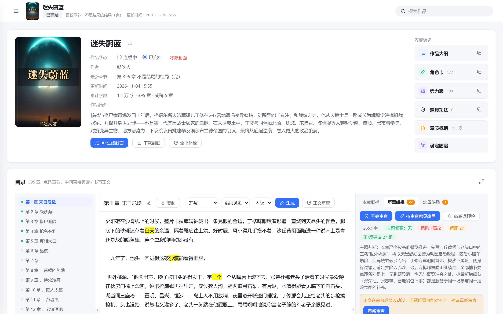 | 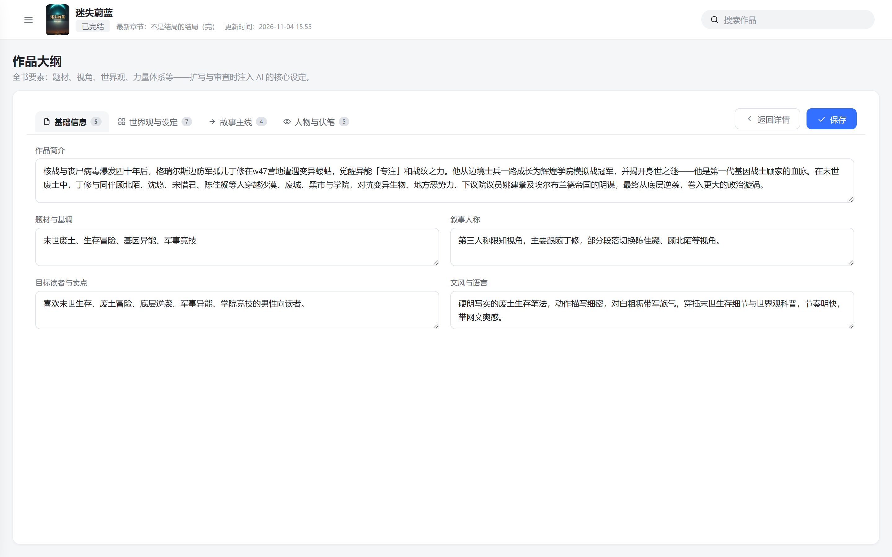 | 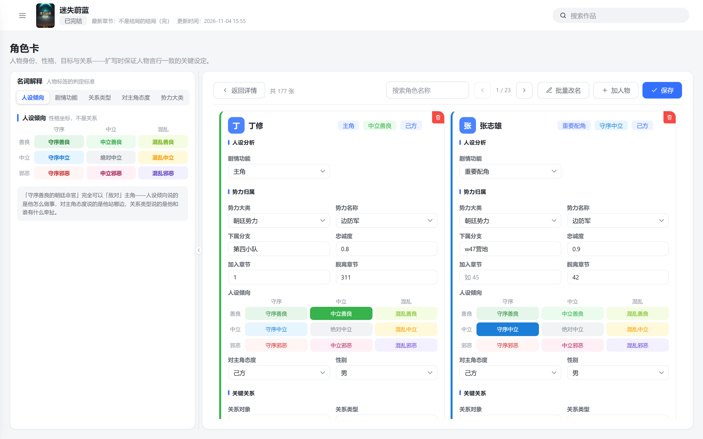 |
| 设定图谱 | 单章体检 | 导出文件 |
| 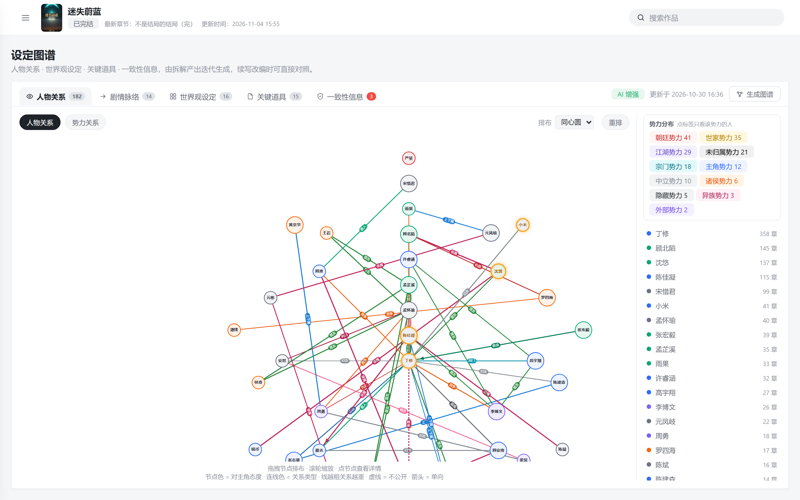 | 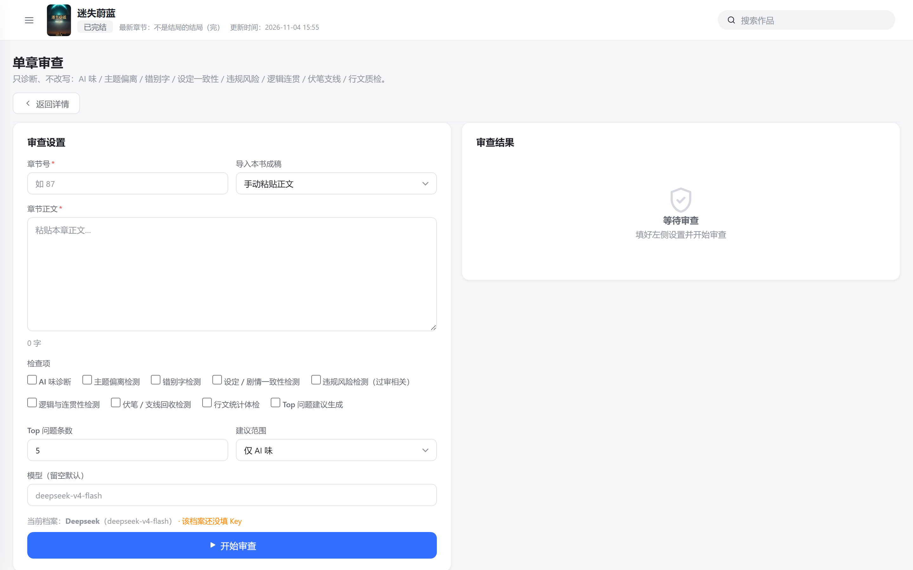 | 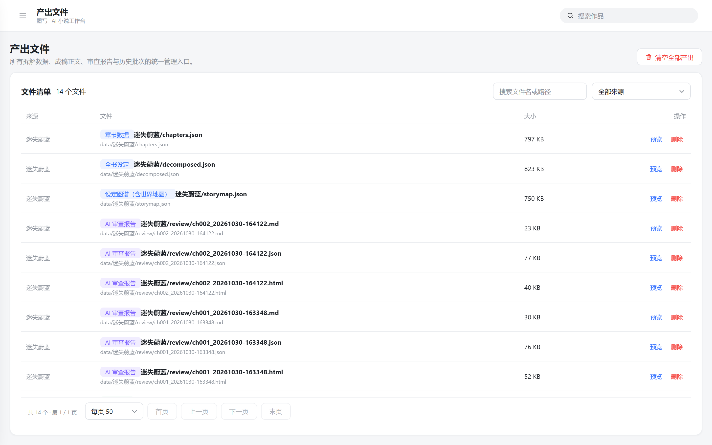 |

### 移动端（Android）

| 总览 | 章节 | 角色 | 大纲 |
| :---: | :---: | :---: | :---: |
| 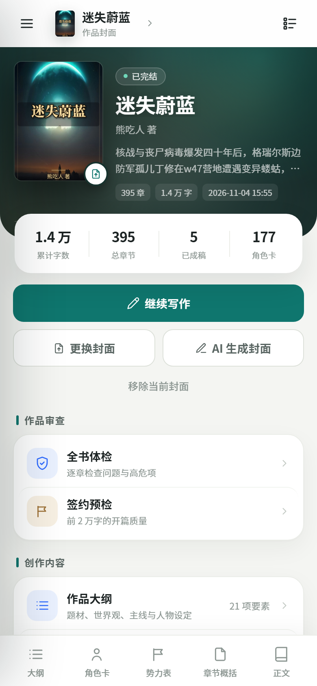 | 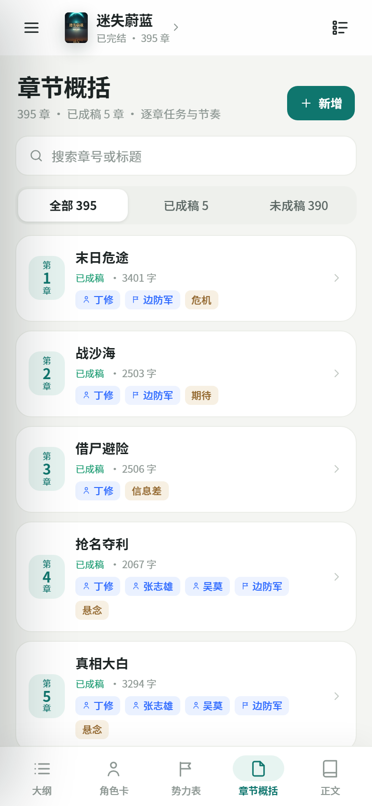 | 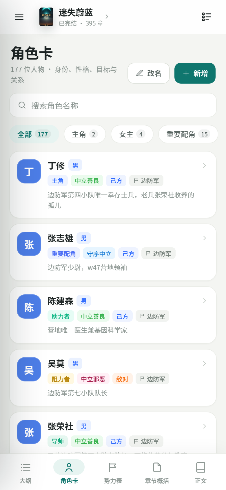 | 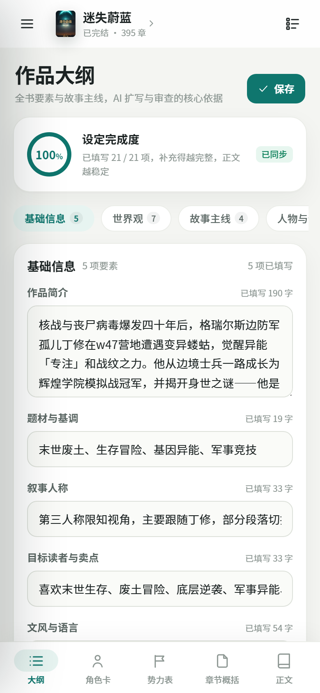 |

> 以上截图均来自离线版真实运行界面（示例数据）。

## 演示视频

<p align="center">
  <a href="docs/演示视频-横版-知乎B站.mp4">
    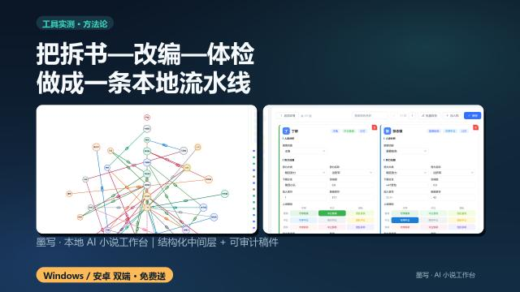
  </a>
  <br/>
  <sub>▲ 点击缩略图或下方链接播放横版演示（知乎 / B 站）</sub>
</p>

- 📺 **横版演示**（知乎 / B 站）：[在知乎观看](https://www.zhihu.com/pin/2103874897516684574?page=video_pin&scene=share) · [仓库内 MP4](docs/演示视频-横版-知乎B站.mp4)
- 📱 **竖版演示**（抖音 / 小红书）：[在小红书观看](https://www.xiaohongshu.com/explore/6af422ad000000002b0031ac?xsec_token=ABKx0HieHic1GwC9AEyfyuxw795U86M5245Qfru9uWLpU=&xsec_source=pc_user) · [仓库内 MP4](docs/演示视频-竖版-抖音小红书.mp4)

---

## 快速开始

- **新手 / 服务器部署（含安全与 HTTPS）**：见 [INSTALL.md](INSTALL.md)
- **本地开发**：仓库根 `start.bat`（Windows 一键起全栈）；在线版用 `start_online.bat`
- **打包部署包**：`bash scripts/package.sh` → 产出 `build/moxie-deploy-*.tar.gz`
- **运维脚本**（部署包内）：`preflight.sh` / `start.sh` / `stop.sh` / `status.sh` / `logs.sh` / `backup.sh` / `restore.sh`

```bash
# 本地一键起全栈（Windows）
start.bat

# 生成可上服务器的部署包（需 Node + bash）
bash scripts/package.sh
```

---

## 离线客户端下载（免安装发行包）

不想自己搭环境？我们打包好了**离线版**发行包，程序与数据都在本机运行：

- 🪟 **Windows 客户端**：单文件 `.exe`，双击即用，无需 Python 环境
- 🤖 **安卓端**：`墨写-手机端` APK，装完本机自跑服务，不连电脑也能用

> ⚠️ **边界说明**：软件本体免费、数据只留本机；AI 拆解 / 生成 / 审查需要联网并**自备模型 Key**（DeepSeek 等，按量自付）。请只用于自己写的或已获授权的稿件，仅供个人非商业使用。目前仅支持 Windows + 安卓（暂无 Mac / iOS / Linux）。

📦 **夸克网盘下载**（Windows 客户端 + 安卓端工具）：

- 链接：https://pan.quark.cn/s/030eb17b271f
- 提取码：`y1pV`

> 也可从源码自行构建：本地起全栈见上方「快速开始」，或 `bash scripts/package.sh` 出部署包。

---

## 赞助墨写

💛 墨写是一个**个人独立开源项目**——没有团队、没有融资、没有广告，也不靠收集你的数据赚钱。

它之所以还能持续更新，靠的是三样东西：

- 💾 **服务器与带宽**：在线演示与文档站点的固定开销；
- 🤖 **模型 API**：开发、调试、演示视频里那些真实跑出来的拆解结果，都是按量付费的；
- ⏳ **作者几乎全部的业余时间**：从架构、合规闸门到每一个字段的交互，都是一点点磨出来的。

软件本体**永远免费、开源、不设订阅墙**——它不会因为没人付费就把功能锁起来；但这也意味着，它能走多远，取决于愿不愿意有人搭一把手。

如果你用过之后觉得「这东西确实帮我省了事」，或者你和我一样相信——**创作者理应拥有一个合规、可控、数据属于自己的 AI 写作工具**——那么请考虑支持我一下。哪怕只是一杯咖啡的钱，都会变成我继续做下去的具体理由。

### 怎么支持

| 方式 | 说明 |
|------|------|
| ⭐ **GitHub Star** | 零成本，但对我很重要——它决定这个工具能不能被更多需要的人看到。 |
| 🥤 **爱发电（月捐）** | https://afdian.com/a/aimoxie — 稳定的月捐最能让我安心投入开发。 |
| 💰 **微信赞赏** | 扫描下方收款码，任意金额都欢迎，留言「墨写」我就知道是你。 |
| 🗣️ **转发与反馈** | 推荐给写长篇的朋友，或提一个认真的 Issue，都是实打实的贡献。 |

<p align="center">
  
  <br/>
  <sub>微信收款码 · 赞赏「墨写 Moxie」</sub>
</p>

### 赞助者回馈

| 档位 | 回馈 |
|------|------|
| ☕ 一杯咖啡（¥20+） | 列入项目鸣谢名单（如你愿意） |
| 🍱 一个月服务器（¥100+） | 需求 / Issue 优先响应 |
| 🚀 长期赞助（¥500+/月） | 联合署名、路线图投票权、定制功能咨询 |

> 赞助不会改变软件的任何功能可用性，也不会给你「特殊版本」——墨写对所有人的开放程度是一样的。赞助去向会在 CHANGELOG 里定期公开。

---

## 路线图

- [ ] 协作写作 / 多人权限
- [ ] 更多模型与本地模型（Ollama）接入
- [ ] 插件 / 提示词市场
- [ ] SaaS 多租户版本

---

## 许可证 License

本项目以 **AGPL-3.0**（Affero 通用公共许可证 v3.0）发布——这是一份强 copyleft 许可证，**即使你把它部署成网络服务（SaaS），衍生修改也必须开源**，非常适合保护这类自托管创作工具的开放性。完整文本见仓库 [LICENSE](LICENSE)。若你对许可证选择有建议，欢迎提 Issue 讨论。

---

<p align="center">
  一个人写的代码，一群人让它走得更远。<br/>
  <b>墨写 Moxie</b> — 让 AI 写小说，合规且安心。
</p>
