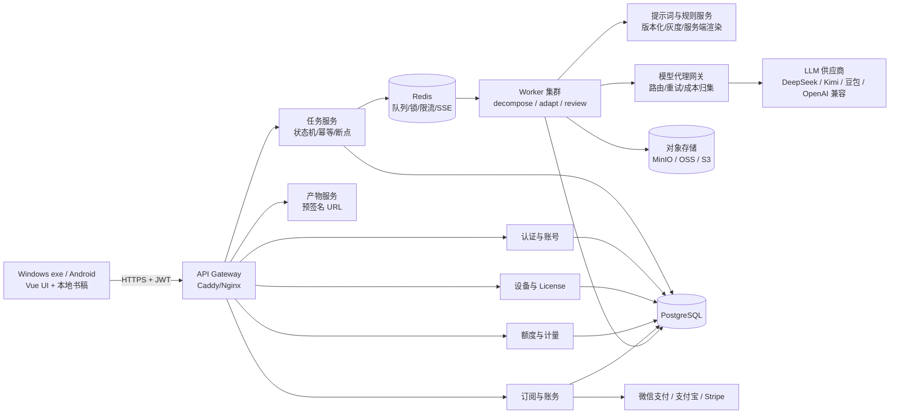
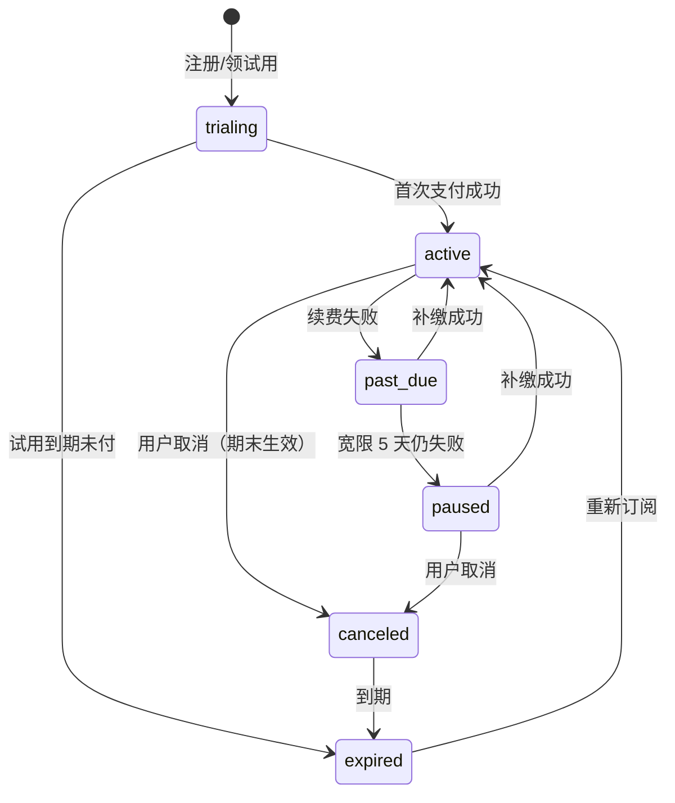

# 墨写服务端架构与订阅计费设计（2026-11）

> 范围：把当前「本地 exe + 本地 Web 服务」改造成「本地客户端 UI + 云端核心能力」，并落地可收费的订阅/额度体系。
> 标注约定：`【代码事实】` 可从仓库代码或构建产物验证；`【建议】` 是设计选择；`【推算】` 是按现有用量/价格做的估算。
> 本文不改代码、不碰 `data/` 下任何书稿。

## 0. 结论先行

1. **形态选「混合」：本地保留 UI、书稿编辑、导入导出和离线宽限；云端接管账号、License、提示词渲染、任务编排、模型代理、额度计量和订阅账务。** 纯本地挡不住提示词泄露，纯 SaaS 又丢掉本地数据与离线优势。
2. **收费的最小闭环不是「加一个支付按钮」，而是四件事连起来：账号 → 设备/License → 服务端权益 → 云端任务与额度。** 缺任何一环，单机版都能被绕过。
3. **提示词与规则库必须只存在于服务端。** `【代码事实】` 当前 `GET /api/prompts` 无鉴权返回全部提示词；`【代码事实】` Nuitka 构建中间产物 `module.decompose.const` / `module.adapt.const` / `module.review.const` 中能直接读到 UTF-8 中文提示词；`【代码事实】` Android APK 内含 24 个 `.pyc` 与明文 `assets/seed/user_prompt_settings.txt`。这三点不解决，云端架构只是把泄露点换个位置。
4. **技术栈沿用 Python 主栈：FastAPI + PostgreSQL + Redis + RQ/Dramatiq + 对象存储 + 自建模型网关 + 现有 Vue 3/Vite。** 不为「看起来先进」换 Node/Go/Java；拆分触发条件写在第 2 节。
5. **两周可上线收费版的最小组合**：FastAPI + Postgres + Redis + RQ + MinIO/OSS + 手机号/邮箱登录 + 设备绑定 + 三类云任务（拆解/改编/体检）+ 模型网关 + 额度预占/结算 + 微信/支付宝一次性支付 + 订阅状态机；砍掉优惠券、自动按比例退款、席位管理、私有化和多区域。

---

## 1. 总体架构选型与理由

### 1.1 推荐形态：本地客户端 UI + 云端核心能力

`【代码事实】` 当前是单进程本地服务：`src/webapp.py` 用 `ThreadingHTTPServer` 监听 `127.0.0.1:8765`，托管 `web/dist`；桌面端每个任务起一个 Python 子进程，手机端（Chaquopy）在后台线程里串行执行；任务表 `JOBS` 在内存里，另有 `TASKS_FILE` 落盘；所有数据在 `data/<书名>/` 下。

`【建议】` 新形态保留这套「本地 UI + 本地文件」的外壳，但把 AI 相关能力改成云端调用：

| 能力 | 本地客户端 | 云端 |
|---|---|---|
| 书稿浏览/编辑/章节管理 | ✅ 主战场 | 仅存快照 |
| 导入导出 docx/md/txt、封面排版 | ✅ 可离线 | 可选备份 |
| 拆解/改编/体检编排 | ❌ 不执行 | ✅ 唯一执行地 |
| 提示词、规则库、schema | ❌ 不下发 | ✅ 加密存储、服务端渲染 |
| 模型调用 | ❌ 不直连供应商 | ✅ 统一网关 |
| 账号、设备、License、订阅 | 只做登录态 | ✅ 权威源 |
| 额度计量、订单、退款 | 只展示 | ✅ 权威源 |
| 书稿主数据 | 本地为主 | 对象存储做备份/跨设备同步 |

### 1.2 为什么不纯本地，也不纯 SaaS

| 形态 | 优点 | 致命问题 | 结论 |
|---|---|---|---|
| 纯本地（现状） | 数据私密、离线、无服务器成本、交付简单 | 提示词必然落进客户端；无法计量/收费/封禁；盗版零成本；升级靠重发 exe | 只能作为「离线编辑器」保留，不能作为收费主体 |
| 纯 SaaS | 提示词安全、计量准确、迭代快 | 几十 MB 书稿上传下载、作者对数据外流敏感、断网不可用、存储与带宽成本上升 | 不适合作为唯一形态 |
| **混合（推荐）** | 本地编辑体验保留；核心能力与计量在云端；可按订阅收费 | 需要处理离线宽限、数据同步、两套状态 | **当前最优** |

`【建议】` 边界原则：**「能产生收入的智能能力」全部上云；「不产生收入但影响体验的编辑能力」留在本地。** 这样即使 exe 被破解，破解版也只能编辑，不能稳定产出。

### 1.3 组件图



纯文本版（便于贴进工单）：

```
客户端(exe/APK)
   │ HTTPS + JWT
   ▼
API Gateway (Caddy/Nginx)
   ├─ 认证/设备/License
   ├─ 任务服务 ──► Redis 队列 ──► Worker(decompose/adapt/review)
   ├─ 额度与计量 ──► PostgreSQL
   ├─ 订阅与账务 ──► 微信/支付宝/Stripe
   └─ 产物服务 ──► 对象存储(MinIO/OSS/S3)

Worker ──► 提示词与规则服务（仅内网，返回渲染后的 prompt）
Worker ──► 模型代理网关 ──► LLM 供应商
Worker ──► 对象存储（中间产物/成稿快照）
```

### 1.4 一次拆解任务的完整链路

1. 客户端 `POST /v1/tasks`，带 `type=decompose`、源文件 artifact id、参数、`Idempotency-Key`。
2. 任务服务校验 JWT + 设备 + 权益，**预占**「1 个标准本」额度；写 `tasks(status=queued)`。
3. 任务服务把 `task_id` 投进 Redis 队列（`rq:decompose`）。
4. Worker 取任务，`UPDATE tasks SET status=running, lease_until=...`；按章节/分块执行。
5. 每个分块前从提示词服务取「已渲染 prompt」（只在内网返回，不落客户端）。
6. 模型网关统一调用供应商，记录 token、耗时、成本，写 `model_calls` 与 `usage_events`。
7. 每完成一个分块写 `task_steps`（唯一键 `task_id+step_key`）与 checkpoint；产物写对象存储。
8. 全部完成：**结算**额度（按实际成功章节/字数），`tasks.status=succeeded`；失败/取消：释放预占，不计费。
9. 客户端通过 SSE 接收进度/日志；断线后可用 `Last-Event-ID` 续传，或轮询 `GET /v1/tasks/{id}`。

---

## 2. 技术栈选型与部署

### 2.1 逐项选型表

| 组件 | 推荐方案 | 备选 | 为什么选它 | 什么时候该换（触发条件） |
|---|---|---|---|---|
| 语言/运行时 | **Python 3.12** | 3.11 | `【代码事实】` 拆解/改编/体检、提示词、schema、Nuitka 构建链全在 Python；Android 也是 `cpython-312` | 不换。只有网关层可独立拆 |
| Web 框架 | **FastAPI + Uvicorn** | Litestar、Flask | 类型校验、OpenAPI、SSE、依赖注入都够用；与现有 Python 模块同进程复用 | API 层 CPU 被打满、p95 > 300ms 且无法靠扩容解决时，把高并发网关拆 Go |
| 数据访问 | **SQLAlchemy 2.0 + Alembic** | asyncpg 裸 SQL、Piccolo | 迁移可审计；事务与行锁写起来清楚；团队上手快 | 出现大量复杂分析查询时，分析走 ClickHouse，不换主库 |
| 主数据库 | **PostgreSQL 16** | MySQL 8 | 行锁、`FOR UPDATE SKIP LOCKED`、JSONB、分区、部分索引都成熟；账单/额度需要强一致 | 单表 > 5,000 万行或 > 100GB 再分区；分析型负载迁 ClickHouse |
| 缓存/队列底座 | **Redis 7** | KeyDB、Valkey | 队列、限流、预占计数、分布式锁、SSE Stream 一个组件全包 | 需要跨地域强一致队列时换云消息队列；当前不需要 |
| 任务队列 | **RQ（MVP）** | Dramatiq、Celery、DB 轮询 | 比 Celery 轻、Redis 直连、任务和异常在 dashboard 里直观；长任务不需要复杂路由 | 需要复杂重试/定时/多队列优先级 → Dramatiq/Celery；需要可恢复工作流 → Temporal |
| 对象存储 | **MinIO（私有化）/ OSS（公有云）** | S3、COS | S3 兼容、预签名 URL、生命周期规则；私有化交付可复用同一套代码 | 单桶 > TB 级或跨区域加速时接 CDN/多区域 |
| 模型网关 | **自建 FastAPI 薄网关** | LiteLLM、OneAPI | 只需统一 key、路由、限流、重试、成本归集；自建可控日志与计费口径 | 需要接 20+ 供应商/复杂配额时再引入 LiteLLM 作为适配层 |
| 前端 | **Vue 3 + Vite（沿用）** | React、Svelte | `【代码事实】` 现有 `web/` 是 Vue 3 + Vite，16 个路由组件已成型；重写没有收益 | 不换；只加云端模式适配层 |
| 认证 | **自建 JWT + Refresh Token** | Auth0、Clerk、Supabase Auth | 国内手机号/微信登录、设备绑定、License 都要自己控；外部 SaaS 反而难接 | 出海且要社交登录时，可接 Supabase/Auth0 做联邦登录 |
| 支付 | **微信支付 v3 + 支付宝 + Stripe** | 聚合支付服务商 | 国内个人/工作室用微信/支付宝；海外用 Stripe；回调与对账都能自己控 | 需要分账/多级商户时接持牌聚合服务 |
| 部署 | **单机 Docker Compose** | 云托管、K8s | 5 个容器（api/worker/postgres/redis/minio/caddy）足够；排障简单 | 需要多节点、自动扩缩、SLA 时上 K8s |
| 反向代理 | **Caddy** | Nginx | 自动 HTTPS、配置短；单机够用 | 需要复杂 WAF/灰度路由时换 Nginx/云网关 |
| 可观测 | **Prometheus + Grafana + Loki + Sentry** | 云监控、Uptime Kuma | 指标/日志/异常三件套；任务队列深度和模型成本必须能看板化 | 团队 < 2 人可先用云监控 + Sentry，Prometheus 后置 |
| CI/CD | **GitHub Actions / GitLab CI** | Jenkins | 构建镜像、跑迁移、部署到单机；不需要自建流水线 | 多环境/多集群时再上 Argo CD |
| 密钥管理 | **云 KMS/Secrets Manager** | SOPS + age、Vault | 提示词、供应商 key、支付密钥不能进仓库；KMS 审计更完整 | 私有化客户要求自带 KMS 时，接 Vault |

### 2.2 为什么不在这个阶段换 Node/Go/Java

- `【代码事实】` `src/decompose.py`、`adapt.py`、`review.py`、`story_bible.py`、`deepseek_common.py` 是完整 Python 流水线；提示词、schema、重试、分块、并发都在 Python 里。换语言等于重写核心资产。
- `【代码事实】` `src/build_app.py` 已用 Nuitka 把 Python 编成原生 exe，`paths.py` 也按 `__compiled__` 做了冻结路径兼容。换语言会把打包链、路径约定、子进程模型全部推倒。
- `【代码事实】` Android 端用 Chaquopy 内嵌 Python 3.12；换语言意味着移动端也要重做。
- **团队认知成本**：当前只有一套 Python 代码和一套数据格式；多语言会同时增加构建、调试、部署、监控四类成本。

`【建议】` 只在两个位置考虑独立拆出：
1. **API 网关/模型网关的高并发层**：当单机 API p95 持续 > 300ms、QPS > 1,000，或需要全球边缘接入时，可把网关用 Go 重写；业务服务仍留 Python。
2. **计量/账单的写入路径**：当用量事件 > 5,000 万行/年、写入成为瓶颈时，可把「事件接收 + 聚合」拆成独立服务（仍可用 Python/Go），主业务不拆。

### 2.3 队列选型对比与长任务机制

| 维度 | Celery | RQ | Dramatiq | 直接 DB 轮询 |
|---|---|---|---|---|
| 依赖 | Redis/RabbitMQ + 较重配置 | 仅 Redis | Redis/RabbitMQ | 仅 Postgres |
| 上手/调试 | 中差，概念多 | **好**，任务即函数 | 好，actor 模型清晰 | 最好，SQL 即队列 |
| 重试/定时 | 强 | 基础 | **较强**（middleware） | 自己写 |
| 取消 | 需 revoke，长任务仍要协作式 | 需自己实现 | 需自己实现 | 自己实现 |
| 吞吐 | 高 | 中 | 中高 | 低（DB 压力） |
| 适用阶段 | 大规模、多队列 | **MVP/单机** | 中期 | < 100 任务/天、只想快速上线 |

`【建议】` **MVP 用 RQ**，因为任务量小（见 2.4）、Redis 已在用、排障直观；把「状态机、幂等、断点」放在 Postgres，而不是押在队列框架上。触发换 Dramatiq/Celery 的条件：> 100 个并发长任务、需要定时批量、需要多优先级队列、重试策略复杂。

**长任务取消 / 断点续跑 / 幂等落库（关键设计）**

- **状态机**：`queued → running → succeeded | failed | canceled`；`running` 带 `lease_until` 与 `heartbeat_at`，worker 崩溃后由清扫任务重新入队。
- **取消**：`POST /v1/tasks/{id}/cancel` 写 `tasks.cancel_requested=true` + Redis `task:cancel:{id}=1`；worker 在「每个模型调用前、每章完成后」检查，抛 `TaskCanceled`；正在进行的 HTTP 请求取消/超时；最后释放预占额度。
- **断点续跑**：每个最小单元（分块/章节/检查项）完成即写 `task_steps(task_id, step_key, status, output_ref)`，唯一键 `(task_id, step_key)`；重跑时跳过已成功步骤。checkpoint 存对象存储，DB 只存引用。
- **幂等**：客户端 `Idempotency-Key` 唯一索引；worker 的每个副作用步骤用 `task_step` 唯一键；用量事件用 `(task_id, metric, seq)` 唯一键；支付回调用 `(provider, event_id)` 唯一键。三层幂等，任何一层重放都不会重复扣费。

### 2.4 数据层规模预估与 Redis 用法

**规模口径**（`【推算】`，按 1,000 付费用户、每人每月 4 本标准本、2 本改编、12 章体检）：

| 表 | 估算 | 说明 |
|---|---|---|
| `users` / `devices` | 1k / 2k | 很小，永远不用分区 |
| `tasks` | 约 1.8 万/月（拆解 4k + 改编 2k + 体检 12k） | 1 年 ~22 万，Postgres 轻松 |
| `task_steps` | 任务的 10–50 倍，约 50 万–90 万/月 | 1 年 ~600 万–1,000 万 |
| `usage_events` | 每次模型调用 1 条：约 25 万–30 万/月 | 1 年 ~300 万–400 万；3 年才需要认真考虑分区 |
| `model_calls` | 与 `usage_events` 同量级 | 可与 usage 合并或分表 |
| `orders` / `subscriptions` | 1k–2k/月 | 很小 |
| `audit_logs` | 取决于敏感操作，估 10 万/月 | 保留 180 天 |

**分区/迁移触发条件**：
- `usage_events` > 2,000 万行或单表 > 50GB，或按月聚合查询 p95 > 200ms → 按 `occurred_at` 月分区。
- 需要「按渠道/模型/章节多维分析」且不影响主库 → 把 `usage_events` 异步投到 ClickHouse；**账单与实时额度仍以 Postgres 为准**。
- `tasks` > 500 万行再按月分区；在此之前用 `(user_id, created_at)` 索引 + 归档即可。

**Redis 键设计**：

| 键 | 用途 | 过期 |
|---|---|---|
| `rl:{scope}:{id}` | 限流计数（登录、任务创建、模型调用） | 60s / 1h，按窗口 |
| `quota:{user_id}:{metric}:{period}` | 额度预占计数（Lua 原子预占/释放） | 周期结束 + 7 天 |
| `task:cancel:{task_id}` | 取消标志 | 1h |
| `task:lease:{task_id}` | worker 租约（可选，DB 也有） | 任务结束 + 1h |
| `sse:{task_id}` | SSE 事件 Stream（`XADD`，`MAXLEN ~1000`） | 1 天 |
| `idem:{key}` | 创建类接口幂等占位 | 24h |
| `session:refresh:{hash}` | Refresh Token 会话 | 30 天 |
| `device:revoked:{device_id}` | 设备吊销快速判断 | 30 天 |
| `prompt:cache:{version}` | 渲染后的提示词短缓存（仅内网） | 10 分钟 |

`【建议】` 额度预占优先用 Redis Lua 原子脚本；Postgres 的 `usage_aggregates` 行锁做二次校验。Redis 丢数据时以 Postgres 为准重建。

### 2.5 部署与成本（单机起步）

**单机 4C8G 粗算口径**（`【推算】`）：

- 任务并发：单任务 5–30 分钟，主要等模型网络 I/O；每 1 个 Python worker 进程同时跑 2–4 个任务（受 `adapt.py` 内部 4 路并发与内存限制）；4C8G 建议 **4–8 个并发长任务**。
- 付费用户：按「每人每月 4 本拆解 + 2 本改编 + 12 章体检」估算，1,000 用户约 200 任务/天，平均 10 分钟，峰值系数 4 → 峰值并发约 5–6。**4C8G 可支撑约 500–800 付费用户**；1,000 以上建议 8C16G + 独立 worker。
- API：FastAPI 2 个 Uvicorn worker，简单读写接口 200–400 rps（不含模型调用）；对本项目远远够用。
- 对象存储：每本书源文 + 中间产物 + 成稿估 50–200MB；1,000 本约 50–200GB。
- 成本：4C8G 云主机约 ¥300–600/月；100GB 对象存储 + 流量约 ¥30–80/月；备份/监控约 ¥50–150/月；**不含模型成本约 ¥400–800/月**。8C16G 约 ¥1,000–2,000/月。`【推算】`

**备份**：
- Postgres：每日全量 + WAL 归档（pgBackRest 或云数据库 PITR），保留 14–30 天；每周做一次恢复演练。
- 对象存储：开启版本控制/生命周期；跨区域复制可后置。
- Redis：不作为权威存储，不备份；丢了下线重建额度缓存。

**监控与日志**：
- Prometheus 指标：任务队列深度、任务成功率、p95 任务时长、模型调用错误率、额度预占失败率、支付回调失败率。
- Grafana 看板：按任务类型/模型/用户分层；成本日报。
- Loki：结构化 JSON 日志，带 `request_id/task_id/user_id_hash`；**不记录提示词、书稿正文、API Key**；保留 30 天。
- Sentry：API/Worker 异常；告警到企业微信/飞书。
- 云监控：主机 CPU/内存/磁盘/带宽；磁盘 > 80% 告警。

### 2.6 与现有单机形态的衔接

**Windows exe（Nuitka）**
- `【代码事实】` 现在 exe 内起本地 HTTP 服务并直接执行子进程；`【代码事实】` 没有账号、License、支付、云端额度。
- `【建议】` 新增「云模式」适配层：本地 UI 仍由 `webapp` 托管，但 AI 相关请求转发到 `https://api.xxx/v1`；登录后把 Refresh Token 存 Windows Credential Manager/DPAPI，**不放 localStorage**。
- 设备注册：启动时生成机器指纹（CPU/主板/磁盘序列的哈希，不采集隐私原文），`POST /v1/devices` 绑定；每席位 2 台。
- 离线宽限：本地缓存一份 **Ed25519 签名的权益快照**（含 `plan`、`exp`、`features`、`device_id`）；断网 14 天内可打开、可编辑、可导出，但云端 AI 任务不可用；超过宽限只读。
- 老数据迁移：首次登录时扫描 `data/<书名>/`，按书打包上传快照（不含密钥），服务端建 `books` 记录；本地仍是主副本，云端只做备份与跨设备。

**Android（Chaquopy）**
- `【代码事实】` APK 的 `assets/chaquopy/app.imy` 含 `decompose.pyc`、`adapt.pyc`、`review.pyc`、`webapp.pyc` 等 24 个模块；`assets/seed/user_prompt_settings.txt` 是明文。
- `【建议】` Android 改成 **薄客户端**：WebView/Compose 只做 UI 与本地缓存，AI 任务全部走云端；APK 内不再放业务 Python 模块，不再放提示词文件。若必须保留 Chaquopy 做本地文件处理，只保留 `paths/export_book` 这类无提示词模块。
- 这样即使 APK 被解包，也拿不到提示词与编排。

### 2.7 如果只给两周上线收费版：选什么、砍什么

**选（必须做）**
- FastAPI + Postgres + Redis + RQ + MinIO/OSS + Caddy；单机 Docker Compose。
- 手机号/邮箱登录 + Refresh Token + 设备绑定 + Ed25519 License 快照。
- 三类任务：拆解、改编、体检；任务状态机、取消、断点、幂等。
- 模型网关：统一 key、超时、重试 2 次、成本归集、预算上限。
- 额度：预占/结算/释放；个人版 4 本/月、200 章/月、体检 4 次/月。
- 支付：微信 Native 扫码 + 支付宝当面付；Webhook 幂等；订阅状态机（试用/活跃/宽限/暂停/取消）。
- 提示词服务端化；删除 `GET /api/prompts`；客户端不再带提示词。

**砍（后置）**
- 自动按比例退款、优惠券引擎、发票自动化、多席位管理、企业私有化、SSO、白标。
- ClickHouse、K8s、多区域、WebSocket、复杂灰度、全自动对账。
- 这些用「人工后台 + CLI」先顶住。

---

## 3. 核心服务拆分与职责

| 服务 | 职责 | 关键规则 |
|---|---|---|
| **认证与账号** | 注册/登录、Refresh Token 轮换、密码/验证码、账号状态 | Access 15 分钟；Refresh 30 天；一设备一会话；改密/封禁即吊销 |
| **设备与 License** | 设备注册、指纹哈希、解绑、吊销、License 快照签名 | 每席位 2 台；指纹只存哈希；License 7 天刷新、14 天离线宽限；吊销列表实时校验 |
| **任务服务** | 创建/查询/取消/续跑；拆解/改编/体检状态机；断点；幂等 | 创建时预占额度；`task_steps` 唯一键；worker 租约与心跳；失败释放 |
| **模型代理网关** | 统一供应商 key、模型路由、限流、超时、重试、成本归集 | 默认非思考/便宜模型；重试上限 2；按任务预算熔断；日志脱敏 |
| **内容与产物存储** | 书稿快照、`decomposed.json`、`chapters.json`、导出文件、预签名 URL | 服务端加密；按用户隔离；下载短时签名；保留策略可配置 |
| **提示词与规则服务** | 模板版本化、灰度、变量渲染、规则库（错别字/敏感词/体检项） | **只内网可读**；不下发明文；任务记录 `prompt_version` 便于复现；发布需审计 |
| **计量与额度** | 预占、结算、释放、聚合、超量、告警 | 事件表为权威；聚合表加速；客户端上报一律不信；跨设备同一账本 |
| **订阅与账务** | 套餐、权益、订单、支付回调、续费、退款、优惠码 | 状态机驱动；Webhook 幂等；日对账；金额用「分」整数 |
| **运营后台** | 用户/订单/任务排查、手动补偿、封禁、提示词版本、模型路由、对账 | 所有操作写 `audit_logs`；双人复核退款/补偿 |

---

## 4. 关键接口设计

**通用约定**
- Base：`https://api.xxx/v1`；除登录/回调外都要 `Authorization: Bearer <access>`。
- 所有创建类 `POST` 支持 `Idempotency-Key`；服务端唯一索引兜底。
- 金额单位：**分**；时间：UTC ISO8601；分页：`cursor`。
- 错误码：`401` 未登录、`403` 无权益/设备超限、`409` 幂等冲突、`422` 参数、`429` 限流、`402` 额度不足。

| 方法 | 路径 | 鉴权 | 幂等 | 说明 |
|---|---|---|---|---|
| POST | `/auth/otp/request` | 无 | 是（手机号+场景） | 发送验证码，限流 1 次/60s |
| POST | `/auth/otp/verify` | 无 | 是 | 验证码换 token；首次登录建账号 |
| POST | `/auth/login` | 无 | 否 | 邮箱/手机号+密码登录 |
| POST | `/auth/refresh` | Refresh | 是 | 轮换 Refresh；旧 token 立即失效 |
| POST | `/auth/logout` | Access | 是 | 吊销当前设备会话 |
| POST | `/devices` | Access | 是 | 注册设备（指纹哈希、平台、名称） |
| GET | `/devices` | Access | — | 设备列表与最近活跃 |
| DELETE | `/devices/{id}` | Access | 是 | 解绑；每 30 天最多 2 次 |
| GET | `/license` | Access | — | 返回 Ed25519 签名权益快照 |
| POST | `/books` | Access | 是 | 建书（标题、来源） |
| GET | `/books` | Access | — | 书列表（含本地/云端版本号） |
| POST | `/uploads/presign` | Access | 是 | 返回预签名 PUT URL + artifact_id |
| POST | `/uploads/{id}/complete` | Access | 是 | 校验 sha256/大小，登记 artifact |
| POST | `/tasks` | Access | **是** | 创建拆解/改编/体检任务；服务端预占额度 |
| GET | `/tasks/{id}` | Access | — | 状态、进度、成本、错误码 |
| GET | `/tasks/{id}/events` | Access | — | **SSE** 日志/进度；支持 `Last-Event-ID` |
| POST | `/tasks/{id}/cancel` | Access | 是 | 协作式取消；释放预占 |
| POST | `/tasks/{id}/resume` | Access | 是 | 从失败/取消处续跑 |
| GET | `/artifacts/{id}/download` | Access | — | 302 到短时预签名 URL |
| GET | `/books/{id}/export` | Access | 是 | docx/md/txt 导出；带水印 |
| GET | `/entitlements` | Access | — | 当前套餐、额度、已用、重置日 |
| GET | `/usage` | Access | — | 用量明细（分页） |
| GET | `/usage/summary` | Access | — | 按任务/模型/日聚合 |
| GET | `/plans` | 无 | — | 套餐与价格（公开） |
| POST | `/subscriptions` | Access | **是** | 购买/开通；返回支付参数 |
| POST | `/subscriptions/{id}/change` | Access | 是 | 升级立即生效；降级下周期 |
| POST | `/subscriptions/{id}/cancel` | Access | 是 | 期末取消/立即取消 |
| POST | `/subscriptions/{id}/resume` | Access | 是 | 宽限/暂停期内恢复 |
| GET | `/orders` | Access | — | 订单列表 |
| POST | `/webhooks/wechat` | 签名 | **是** | 支付回调；验签 + event_id 唯一 |
| POST | `/webhooks/alipay` | 签名 | **是** | 同上 |
| POST | `/webhooks/stripe` | 签名 | **是** | 同上 |
| GET | `/healthz` | 无 | — | 存活 |
| GET | `/readyz` | 无 | — | DB/Redis/存储就绪 |

**长任务用 SSE、轮询兜底，不用 WebSocket。**
- SSE 单向、HTTP/2 友好、断线重连简单；任务日志天然是「服务端推、客户端收」。
- 事件格式：`event: progress|log|done|error`，`data: {"seq":..,"pct":..,"msg":..}`。
- 客户端每 3–5 秒轮询 `GET /tasks/{id}` 作为兜底；SSE 断线用 `Last-Event-ID` 续传。
- WebSocket 只在未来需要「多人协同编辑/实时双向」时再上。

---

## 5. 数据模型

### 5.1 核心表（可直接照着写）

```sql
-- 账号
CREATE TABLE users (
  id              BIGSERIAL PRIMARY KEY,
  email           TEXT UNIQUE,
  phone           TEXT UNIQUE,
  password_hash   TEXT,
  status          TEXT NOT NULL DEFAULT 'active',  -- active|disabled|deleted
  created_at      TIMESTAMPTZ NOT NULL DEFAULT now(),
  updated_at      TIMESTAMPTZ NOT NULL DEFAULT now()
);

-- 设备（指纹只存哈希）
CREATE TABLE devices (
  id              BIGSERIAL PRIMARY KEY,
  user_id         BIGINT NOT NULL REFERENCES users(id),
  device_hash     TEXT NOT NULL,
  platform        TEXT NOT NULL,                  -- windows|android|web
  name            TEXT,
  last_seen_at    TIMESTAMPTZ,
  status          TEXT NOT NULL DEFAULT 'active',  -- active|revoked
  created_at      TIMESTAMPTZ NOT NULL DEFAULT now(),
  UNIQUE (user_id, device_hash)
);

-- 套餐与权益
CREATE TABLE plans (
  id              BIGSERIAL PRIMARY KEY,
  code            TEXT UNIQUE NOT NULL,            -- personal_byok|personal_managed|studio...
  name            TEXT NOT NULL,
  price_month_cents INTEGER NOT NULL,
  price_year_cents  INTEGER NOT NULL,
  currency        TEXT NOT NULL DEFAULT 'CNY',
  features        JSONB NOT NULL DEFAULT '{}',
  active          BOOLEAN NOT NULL DEFAULT true
);

CREATE TABLE entitlements (
  id              BIGSERIAL PRIMARY KEY,
  plan_id         BIGINT NOT NULL REFERENCES plans(id),
  key             TEXT NOT NULL,                   -- books_month|adapt_chapters|managed_chars|concurrency|seats|review_month
  limit_value     BIGINT NOT NULL,
  unit            TEXT NOT NULL,                   -- count|chars|seats
  reset_period    TEXT NOT NULL DEFAULT 'month',
  overage_price_cents BIGINT,
  UNIQUE (plan_id, key)
);

-- 订阅（同一用户同一时间只允许一个活跃订阅）
CREATE TABLE subscriptions (
  id              BIGSERIAL PRIMARY KEY,
  user_id         BIGINT NOT NULL REFERENCES users(id),
  plan_id         BIGINT NOT NULL REFERENCES plans(id),
  status          TEXT NOT NULL,                   -- trialing|active|past_due|paused|canceled|expired
  seats           INT NOT NULL DEFAULT 1,
  trial_end_at    TIMESTAMPTZ,
  current_start_at TIMESTAMPTZ NOT NULL,
  current_end_at   TIMESTAMPTZ NOT NULL,
  cancel_at_period_end BOOLEAN NOT NULL DEFAULT false,
  provider        TEXT,                            -- wechat|alipay|stripe|manual
  provider_sub_id TEXT,
  version         INT NOT NULL DEFAULT 1,
  created_at      TIMESTAMPTZ NOT NULL DEFAULT now(),
  updated_at      TIMESTAMPTZ NOT NULL DEFAULT now()
);
CREATE UNIQUE INDEX uq_sub_active ON subscriptions(user_id)
  WHERE status IN ('trialing','active','past_due','paused');

-- 订单
CREATE TABLE orders (
  id              BIGSERIAL PRIMARY KEY,
  user_id         BIGINT NOT NULL REFERENCES users(id),
  subscription_id BIGINT REFERENCES subscriptions(id),
  amount_cents    BIGINT NOT NULL,
  currency        TEXT NOT NULL DEFAULT 'CNY',
  status          TEXT NOT NULL,                   -- pending|paid|failed|refunded
  provider        TEXT,
  provider_txn_id TEXT,
  coupon_id       BIGINT,
  paid_at         TIMESTAMPTZ,
  created_at      TIMESTAMPTZ NOT NULL DEFAULT now()
);
CREATE INDEX idx_orders_user ON orders(user_id, created_at DESC);
CREATE UNIQUE INDEX uq_orders_provider_txn ON orders(provider, provider_txn_id)
  WHERE provider_txn_id IS NOT NULL;

-- 任务
CREATE TABLE tasks (
  id              UUID PRIMARY KEY,
  user_id         BIGINT NOT NULL REFERENCES users(id),
  book_id         BIGINT,
  type            TEXT NOT NULL,                   -- decompose|adapt|review
  status          TEXT NOT NULL,                   -- queued|running|succeeded|failed|canceled
  params          JSONB NOT NULL DEFAULT '{}',
  input_artifact  TEXT,
  output_artifact TEXT,
  progress        INT NOT NULL DEFAULT 0,
  cost_estimate_cents BIGINT,
  cost_actual_cents   BIGINT,
  prompt_version  TEXT,
  idempotency_key TEXT,
  cancel_requested BOOLEAN NOT NULL DEFAULT false,
  attempts        INT NOT NULL DEFAULT 0,
  lease_until     TIMESTAMPTZ,
  heartbeat_at    TIMESTAMPTZ,
  error_code      TEXT,
  created_at      TIMESTAMPTZ NOT NULL DEFAULT now(),
  started_at      TIMESTAMPTZ,
  finished_at     TIMESTAMPTZ,
  UNIQUE (user_id, idempotency_key)
);
CREATE INDEX idx_tasks_status_lease ON tasks(status, lease_until);
CREATE INDEX idx_tasks_user_time ON tasks(user_id, created_at DESC);

-- 任务步骤（断点/幂等）
CREATE TABLE task_steps (
  task_id         UUID NOT NULL REFERENCES tasks(id),
  step_key        TEXT NOT NULL,                   -- chunk:01|chapter:012|check:typo
  status          TEXT NOT NULL,                   -- running|done|failed
  output_ref      TEXT,
  updated_at      TIMESTAMPTZ NOT NULL DEFAULT now(),
  PRIMARY KEY (task_id, step_key)
);

-- 用量事件（权威账本）
CREATE TABLE usage_events (
  id              BIGSERIAL PRIMARY KEY,
  user_id         BIGINT NOT NULL REFERENCES users(id),
  task_id         UUID,
  metric          TEXT NOT NULL,                   -- decompose_book|adapt_chapter|review_call|model_token
  quantity        BIGINT NOT NULL,                 -- 本|章|次|token
  unit            TEXT NOT NULL,
  idempotency_key TEXT NOT NULL,
  occurred_at     TIMESTAMPTZ NOT NULL DEFAULT now(),
  meta            JSONB NOT NULL DEFAULT '{}',     -- model, prompt_tokens, completion_tokens, price snapshot
  UNIQUE (user_id, idempotency_key)
);
CREATE INDEX idx_usage_user_time ON usage_events(user_id, occurred_at DESC);
CREATE INDEX idx_usage_task ON usage_events(task_id);

-- 额度聚合（加速校验）
CREATE TABLE usage_aggregates (
  user_id         BIGINT NOT NULL REFERENCES users(id),
  metric          TEXT NOT NULL,
  period_start    DATE NOT NULL,
  period_end      DATE NOT NULL,
  used            BIGINT NOT NULL DEFAULT 0,
  reserved        BIGINT NOT NULL DEFAULT 0,
  updated_at      TIMESTAMPTZ NOT NULL DEFAULT now(),
  PRIMARY KEY (user_id, metric, period_start)
);
```

### 5.2 其余表（字段从简）

| 表 | 关键字段 | 索引/约束 |
|---|---|---|
| `refresh_sessions` | `id, user_id, device_id, token_hash, expires_at, revoked_at, rotated_from` | `(token_hash) UNIQUE`；`(user_id, device_id)` |
| `books` | `id, user_id, title, status, source_artifact, local_rev, cloud_rev, created_at` | `(user_id, created_at)` |
| `artifacts` | `id, user_id, book_id, task_id, kind, object_key, size, sha256, watermark_id, expires_at` | `(user_id, created_at)`；`(sha256)` |
| `task_events` | `task_id, seq, level, message, created_at` | `PRIMARY KEY(task_id, seq)` |
| `model_calls` | `task_id, user_id, provider, model, prompt_tokens, completion_tokens, cost_cents, latency_ms, status` | `(user_id, created_at)`；`(task_id)` |
| `prompt_versions` | `key, version, content_ciphertext, status, rollout_pct, created_by, created_at` | `UNIQUE(key, version)`；每个 key 仅一个 `active` |
| `rulesets` | `key, version, object_key, status, created_at` | `UNIQUE(key, version)` |
| `coupons` | `code, type, value, max_uses, used, valid_from, valid_to, plan_codes` | `UNIQUE(code)` |
| `refunds` | `order_id, amount_cents, reason, status, provider_refund_id, created_by` | `(order_id)` |
| `webhook_events` | `provider, event_id, payload, processed_at` | `UNIQUE(provider, event_id)` |
| `audit_logs` | `actor_id, action, target_type, target_id, ip, ua, meta, created_at` | `(actor_id, created_at)`；`(target_type, target_id)` |
| `billing_profiles` | `user_id, type(person/company), title, tax_no, email` | `UNIQUE(user_id)` |

### 5.3 为什么用量用「事件表 + 聚合表」而不是直接计数

- **可审计**：每一笔扣费都能追溯到 `task_id + metric + 模型 token`，退款/争议时能解释。
- **幂等**：唯一键让重试、重复回调、worker 重跑都不会重复扣费。
- **可修正**：失败任务释放、部分成功按比例结算，都能用「冲正事件」而不是改一个总数。
- **跨设备一致**：聚合键是 `user_id + metric + period`，换设备、重装客户端都不影响。
- **性能**：实时校验读聚合表；明细异步写；两者最终一致，日对账兜底。
- **反作弊**：异常模式（短时间大量任务、同一设备多账号）在事件层更容易识别。

---

## 6. 订阅与计费机制

### 6.1 权益模型：套餐 → entitlements → 服务端强校验

`【建议】` 套餐只定义「卖什么」，所有限制落到 `entitlements` 行；服务端在**创建任务前**校验，不信任客户端。

| 套餐 | 月/年 | 拆解（标准本/月） | 改编（章/月） | 托管正文（字/月） | 并发 | 席位 | 体检 | 存储 |
|---|---|---|---|---|---|---|---|---|
| 个人 BYOK | ¥29 / ¥249 | 4 | 200 | — | 2 | 1 | 4 次/月 | 2GB |
| 个人托管 | ¥49 / ¥399 | 4 | 200 | 30 万 | 2 | 1 | 4 次/月 | 5GB |
| 工作室 BYOK | ¥199 / ¥1,599 | 20 | 1,000 | — | 4 | 3 | 公平使用 | 20GB |
| 工作室托管 | ¥299 / ¥2,399 | 20 | 1,000 | 200 万 | 4 | 3 | 公平使用 | 50GB |
| 企业私有化 | ¥19,800/年起 | 100 本/年 | 5,000 章/年 | 按合同 | 8 | 10 | 不限 | 按合同 |
| 短剧项目制 | ¥499/部 | 按项目 | 按项目 | 按项目 | 2 | 1 | ¥99/次 | 按项目 |

- **标准本定义**：≤20 万字、≤50 章；超出按 1.5–2 个标准本计。
- **强校验点**：`POST /v1/tasks` 时检查 `plan.status`、`entitlements`、`reserved + used < limit`、并发数、设备数；不足返回 `402`。
- **功能开关**：`features` JSONB 只由服务端读取并签名进 License；客户端只做展示，不做判断。
- **席位**：工作室按 `seats` 计；第 4 席起 ¥39/席/月（`【建议】`，与商业计划书一致）。

### 6.2 计量点设计与防重复

| 计量点 | 何时打点 | 预占 | 结算 | 防重 |
|---|---|---|---|---|
| 拆解输入字数 | 创建任务时按源文字符数估算标准本数 | 预占 N 本 | 成功后按实际成功章节/字数结算；失败全退 | `(task_id, 'decompose_book')` 唯一 |
| 拆解输出章节数 | 每个分块成功落盘 | — | 部分成功按章节比例结算 | `task_steps` 唯一 |
| 改编输出字数 | 每章成功落盘 | 按源章数预占 N 章 | 按成功新章节数结算 | `(task_id, 'adapt_chapter', seq)` 唯一 |
| 体检次数 | 创建体检任务时 | 预占 1 次 | 成功出报告才扣；模型失败不扣 | `(task_id, 'review_call')` 唯一 |
| 模型 token | 每次模型调用返回 usage | 不预占（含在任务预算内） | 用于成本归集与托管额度；BYOK 不扣用户 token | `(task_id, 'model_token', call_seq)` 唯一 |
| 存储 | 每日聚合对象存储用量 | — | 超出套餐按 GB/月 | 以对象存储清单为准 |

**跨设备一致**：额度账本键是 `user_id`，不是设备；设备只影响并发和 License。客户端本地 `usage.jsonl` 只用于展示，**永不作为账单依据**（`【代码事实】` 当前它可被用户直接删改）。

### 6.3 订阅状态机



- **试用**：7 天或 1 个标准本，二者先到为准；每个手机号/设备/支付工具只一次。
- **宽限**：`past_due` 5 天，功能可用但提示补缴；第 6 天进 `paused`，只读 + 不可新建任务。
- **取消**：默认期末生效；立即取消按未使用天数退（见退款策略）。
- **升级**：立即生效，按日比例折算旧套餐剩余价值，补差价。
- **降级**：下个周期生效，避免当天反复升降。
- **年付**：按 10 个月价格（约 83 折）；年付中途退款按未使用整月扣减已用额度。

### 6.4 支付集成

| 渠道 | 适用 | 订阅能力 | 关键点 |
|---|---|---|---|
| 微信支付 v3 | 国内桌面扫码/H5 | 周期扣款需满足商户类目；否则「到期提醒 + 手动续费」 | 回调验签、`out_trade_no` 幂等、退款原路 |
| 支付宝 | 国内网页/手机 | 周期扣款需签约；否则同上 | 异步通知验签、`trade_no` 幂等 |
| Stripe | 海外 | 原生订阅、自动续费、发票 | Checkout + Webhook；税率/币种 |

- **回调幂等**：`webhook_events(provider, event_id)` 唯一；先落库再异步处理；重复回调直接 200。
- **对账**：每日拉供应商账单，与 `orders` 三方对账（供应商/本地订单/额度结算）；差异 > 1% 告警。
- **发票**：国内人工开票（后台记录抬头/税号）；Stripe 自动发票。
- **退款**：个人 7 天内且用量 < 20% 可退；年付扣已用整月；企业 30 天验收；已消耗额度不退；盗版/共享账号不退款。

### 6.5 免费试用与防滥用

- 设备指纹哈希 + 手机号验证 + 支付工具指纹；三选二才算「新用户」。
- 试用额度硬上限：1 本拆解、20 章改编、1 次体检；并发 1。
- 异常告警：同一 IP/设备短时间注册 > 3 个账号、单日任务 > 50、额度消耗突增 5 倍。
- 产出水印：试用版导出带不可见指纹；便于追溯倒卖。
- 风控动作：限流 → 人工审核 → 暂停试用 → 封禁。

### 6.6 BYOK 与托管两条线如何共存

| 维度 | BYOK | 托管 |
|---|---|---|
| 收费 | 软件 + 编排 + 云任务费 | 订阅含模型额度 |
| 模型成本 | 用户承担 | 平台承担 |
| Key 处理 | 客户端持有；每次任务随请求上行，服务端**内存使用、不落盘、不日志**；可选信封加密 | 平台统一 key，用户无感 |
| 额度 | 只计任务单位（本/章/次） | 任务单位 + token/字数额度 |
| 毛利 | 高（~90%+） | 中（70%–89%） |
| 风险 | Key 泄露/被滥用；需限流与审计 | 重度用户击穿毛利；需预算与熔断 |

`【建议】` BYOK 也走服务端网关，而不是客户端直连供应商——否则提示词必须下发，等于回到泄露老路。Key 只在该任务生命周期内存在，任务结束即清零；日志与错误上报统一脱敏。

### 6.7 模型成本控制

- **默认路由**：`deepseek-v4-flash` 非思考模式；体检/逻辑校验可按用户开关升到 pro。
- **预算**：创建任务时按字数估算成本（`【代码事实】` 实测拆解约 ¥0.056–0.187/万字），设 **1.5–2 倍硬上限**；超限暂停并让用户确认。
- **重试**：最多 2 次，指数退避；重试成本计入任务，不向用户重复计费。
- **缓存**：系统提示词/规则块走供应商 prompt cache；相同书稿的重复体检命中结果缓存。
- **熔断**：供应商错误率 > 5%（1 分钟窗口）→ 打开 30 秒，切备用模型/供应商。
- **日预算**：平台级日成本上限 + 用户级日成本上限；超限告警并降级到便宜模型。
- **计量**：每笔 `model_calls` 记录单价快照，改价不回溯旧账（沿用 `usage.py` 的思路）。

---

## 7. 安全与防泄露

| 风险 | 现状（代码事实） | 目标措施 |
|---|---|---|
| 提示词被直接读取 | `GET /api/prompts` 无鉴权返回全部 `default/effective` | 删除该端点；提示词只在内网由 Worker 读取；客户端只拿结果 |
| 提示词在二进制里 | Nuitka `.const` 有 UTF-8 明文中文提示词 | 提示词移服务端；客户端不再编译提示词模块；构建产物做字符串扫描 |
| APK 带源码 | `app.imy` 含 24 个 `.pyc` + 明文 `user_prompt_settings.txt` | Android 薄客户端；移除业务 `.pyc` 与提示词文件 |
| 前端可抄 | `web/dist` 无 sourcemap，但 JS/CSS/文案可读 | 接受 UI 可抄；把价值放在服务端能力与数据，不靠隐藏 UI |
| License 被伪造 | 当前无 License | Ed25519 签名权益快照；公钥内置客户端；7 天刷新；吊销列表 |
| 设备共享 | 当前无设备绑定 | 每席位 2 台；指纹哈希；解绑限频；异常设备人工审核 |
| 额度被改 | 本地 `usage.jsonl` 可删改 | 服务端事件账本为权威；客户端只展示；预占/结算在服务端 |
| 产物被转卖 | 无 | 导出加不可见指纹（零宽字符 + 词汇指纹）；公开渠道抽样检测 |
| 密钥泄露 | Key 存浏览器 `localStorage`（`SettingsModal.vue`） | 云端模式改系统凭据库；服务端 KMS；日志脱敏；最小权限 |
| 重放/中间人 | 本地 HTTP 无鉴权 | 全站 HTTPS；License/设备接口加 nonce+timestamp+HMAC；可选证书固定 |
| 越权访问 | 本地单用户 | 所有资源按 `user_id` 过滤；对象存储预签名短时有效；审计日志 |

**原则**：不追求「客户端绝对不可破解」，追求「破解后没有云服务就不产生价值」。代码加固（Nuitka、签名、完整性校验、反调试）只提高成本；真正的防线是服务端权益、提示词、规则库和持续更新。

---

## 8. 迁移路线

### 8.1 三期

| 期 | 时间 | 必须做 | 可以后置 | 兼容老用户 |
|---|---|---|---|---|
| **P0 最小可收费** | 0–1 个月 | FastAPI/Postgres/Redis/RQ/对象存储；登录+设备+License；拆解/改编/体检三类云任务；模型网关；额度预占/结算；微信/支付宝支付+回调；订阅状态机；删除 `/api/prompts`；提示词服务端化 | 优惠券、自动退款、发票、席位、运营后台 UI、水印检测、对账自动化 | 老用户保留本地编辑/导出；赠 30 天过渡 License；云端任务可选 |
| **P1 计量与运营** | 1–3 个月 | 用量明细/聚合看板；运营后台（用户/订单/任务/补偿）；试用风控；SSE；提示词版本与灰度；日对账；备份/监控/告警；退款流程 | 多支付渠道、发票自动化、复杂优惠 | 本地数据一键上传快照；跨设备同步 |
| **P2 工作室与私有化** | 3–6 个月 | 多席位、团队书库、角色权限；私有化部署包（Compose + 离线 License）；SSO；SLA；白标；审计增强 | ClickHouse、K8s、多区域、WebSocket 协同 | 企业客户本地部署 + 云端 License 校验（可选离线） |

### 8.2 与现有单机用户兼容

- **不强制迁移**：老 exe 继续可用本地编辑/导出；AI 功能在新区块链版本里转为云调用。
- **过渡 License**：老用户登录后自动获得 30 天等价权益，避免「更新即不能用」。
- **数据迁移**：首次登录扫描 `data/<书名>/`，按书打包上传；服务端只存快照与产物，不覆盖本地。
- **离线宽限**：14 天签名快照；超期只读，不丢数据。
- **旧版退役**：新 exe 发布后，旧版不再提供下载；旧版 `GET /api/prompts` 通过服务端不依赖它，但二进制里的提示词无法回收，只能靠后续版本替换。

---

## 9. 风险与取舍

| 风险 | 影响 | 取舍/缓解 |
|---|---|---|
| 云端任务增加延迟 | 用户点「拆解」后要等排队 + 网络 + 模型 | SSE 进度、区域部署、任务预估时间、失败快速重试；本地保留预览 |
| 离线不可用 | 断网无法拆解/改编 | 本地编辑/导出可用；14 天宽限；企业私有化提供离线网关 |
| 成本随规模上升 | 托管重度用户击穿毛利 | 额度化、默认便宜模型、预算熔断、BYOK 分流、缓存 |
| 合规 | 个人信息、支付、内容审核、数据出境 | 最小化采集；支付走持牌渠道；内容审核与平台规则；数据境内存储；隐私政策/告知同意 |
| 运维负担 | 单机故障、备份、升级 | Docker Compose + 一键脚本；每日备份 + 月度演练；告警到 IM；P0 只保核心 |
| 支付订阅限制 | 微信/支付宝自动续费受类目限制 | 到期提醒 + 手动续费兜底；Stripe 仅海外；不承诺「一定自动扣」 |
| 供应商锁定 | 模型/云厂商涨价 | OpenAI 兼容抽象；模型路由可切换；对象存储 S3 兼容 |
| 数据锁定 | 用户不愿上传 | 本地为主、云端备份可选；随时导出；删除账号即删数据 |
| 破解 | 客户端被改 | 接受 UI 可抄；核心在服务端；License + 设备 + 水印 + 低价降低动机 |

---

## 10. 一页结论

### 最优先落地的 5 件事

1. **提示词服务端化**：删除 `GET /api/prompts`，提示词/规则库加密存服务端，Worker 内网渲染，客户端只拿结果。
2. **账号 + 设备 + License + 权益**：JWT/Refresh、设备指纹、Ed25519 签名快照、7 天刷新/14 天离线宽限。
3. **云任务 + 模型网关 + 额度**：拆解/改编/体检三类任务状态机、断点、幂等；统一模型 key、路由、重试、成本归集；预占/结算/释放。
4. **支付与订阅状态机**：微信/支付宝回调幂等、订单/订阅/宽限/取消；金额用分、日对账。
5. **客户端瘦身**：Windows 不再编译提示词模块；Android 去掉 `.pyc` 与明文提示词，改薄客户端。

### 现在不建议做

- K8s、多区域、微服务拆分、ClickHouse、WebSocket 协同。
- 自建支付/资金池、复杂优惠券引擎、全自动按比例退款。
- 完整企业私有化、SSO、白标（等 P2）。
- 把「防破解」当核心战略；核心是服务端能力 + 持续迭代 + 合理价格。

### 两周验收标准

- 新用户能注册、绑设备、领试用、买个人版。
- 能创建拆解/改编/体检任务，看到 SSE 进度，成功后下载产物。
- 额度不足返回 `402`；失败/取消不扣费；重复请求不重复扣费。
- 客户端抓包/解包看不到任何提示词明文；`/api/prompts` 返回 404。
- 支付回调重复发送不重复开通；订单与订阅状态一致。

---

### 附：与现有代码的对应关系

| 现有实现 | 迁移后 |
|---|---|
| `src/webapp.py` 的 `ThreadingHTTPServer` + `JOBS` | FastAPI 路由 + `tasks` 表 + RQ |
| `src/decompose.py` / `adapt.py` / `review.py` 子进程 | Worker 导入同一套模块，改为服务端任务 |
| `src/deepseek_common.py` 直连供应商 | 改为调用模型网关（保留 OpenAI 兼容） |
| `src/usage.py` 本地 `usage.jsonl` | 服务端 `usage_events` + `usage_aggregates`；本地仅展示 |
| `src/prompts.py` 注册表 + `/api/prompts` | 服务端提示词版本服务，删除公开端点 |
| `src/studio.py` 本地模型档案/Key 在 localStorage | 云端模型路由 + BYOK 临时 key；Key 不进日志 |
| `src/build_app.py` Nuitka 打包 | 保留；去掉提示词模块，加完整性校验/签名 |
| `mobile/.../app.imy` 的 `.pyc` | 薄客户端；不再打包业务 Python |
